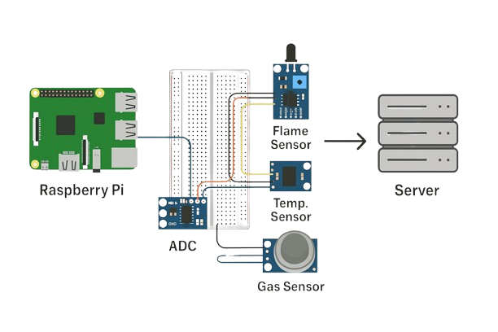

# Emergency Fire Notification System

A Raspberry Pi IoT system that watches gas, flame, and temperature sensors and emails a guardian when a reading crosses a danger threshold.

Team project for the IoT course at Hankuk University of Foreign Studies (2 members, presented June 2025).



## How it works

| Step | Where | What happens |
| --- | --- | --- |
| 1 | Raspberry Pi (C) | Reads the three analog sensors through an ADC over SPI |
| 2 | Raspberry Pi (Python) | Runs the C reader, parses its output, and writes each reading to Firestore with a server timestamp |
| 3 | Firestore | Stores the readings in the `fire_detection_system_final` collection. Each new document fires an event |
| 4 | Cloud Functions (Python) | Checks the new reading against thresholds and sends an alert email if any sensor is in danger |

## Hardware

| Part | Connection |
| --- | --- |
| Gas sensor | ADC channel 1 |
| Flame sensor | ADC channel 2 |
| Temperature sensor | ADC channel 3 |
| ADC | SPI channel 0 at 500 kHz, chip select on GPIO (wiringPi pin 29) |
| Breadboard | Wiring between the Raspberry Pi, the ADC, and the sensors |

The Raspberry Pi has no analog input pins, so the analog sensor outputs go through an ADC and are read over SPI.

Reading one channel (`readADC` in `raspberry-pi/IOT_project_draft.c`):

1. Pull chip select low.
2. Send 3 bytes with the start bit and channel number, and receive 3 bytes back at the same time (`wiringPiSPIDataRW`).
3. Combine the lower 4 bits of the second byte and the third byte into a 12-bit value.
4. Pull chip select high.

## Alert rules

The Cloud Function compares each new reading with these thresholds. They are function parameters, so they can be changed without editing the code.

| Sensor | Danger when | Default |
| --- | --- | --- |
| Gas | value is at or above the threshold | 50 |
| Temperature | value is at or below the threshold (a lower ADC value means a higher temperature) | 10 |
| Flame | value is at or below the threshold (a lower ADC value means a flame is more likely) | 11 |

The alert email lists which sensors triggered it, the detection time in Korea Standard Time, the Firestore log ID, and the full sensor values.

The Gmail account and password are stored in Secret Manager (`GMAIL_EMAIL`, `GMAIL_PASSWORD`), not in the code. The recipient is set with the `ALERT_RECIPIENT_EMAIL` parameter.

## Repository layout

```
functions/
  main.py            Cloud Function: threshold check and alert email
  requirements.txt
raspberry-pi/
  IOT_project_draft.c   Early draft of the sensor reader (SPI and ADC part)
docs/
  architecture.png
```

## Deploying the Cloud Function

```
firebase functions:secrets:set GMAIL_EMAIL
firebase functions:secrets:set GMAIL_PASSWORD
firebase deploy --only functions
```

The function runs in `asia-northeast3` (Seoul).

## Notes

The final versions of the C sensor reader (`IOT_read.c`) and the Firestore upload script (`send_to_firestore.py`) used in the demo were not kept. This repository has the Cloud Function that ran in the demo and an early draft of the C reader. The draft shows the SPI and ADC code, but its main loop is unfinished and it does not compile as is.

Known issue found in review: the code keeps `value & 0x3F`, which drops the upper 6 bits of the 12-bit reading and keeps only the lower 6, so the value wraps every 64 steps. Scaling the 12-bit value down to 0 to 63 should use `value >> 6` instead. The thresholds above were set for the 0 to 63 range.

## Tech

C, wiringPi, SPI, Python, Firebase Firestore, Google Cloud Functions, Gmail SMTP
